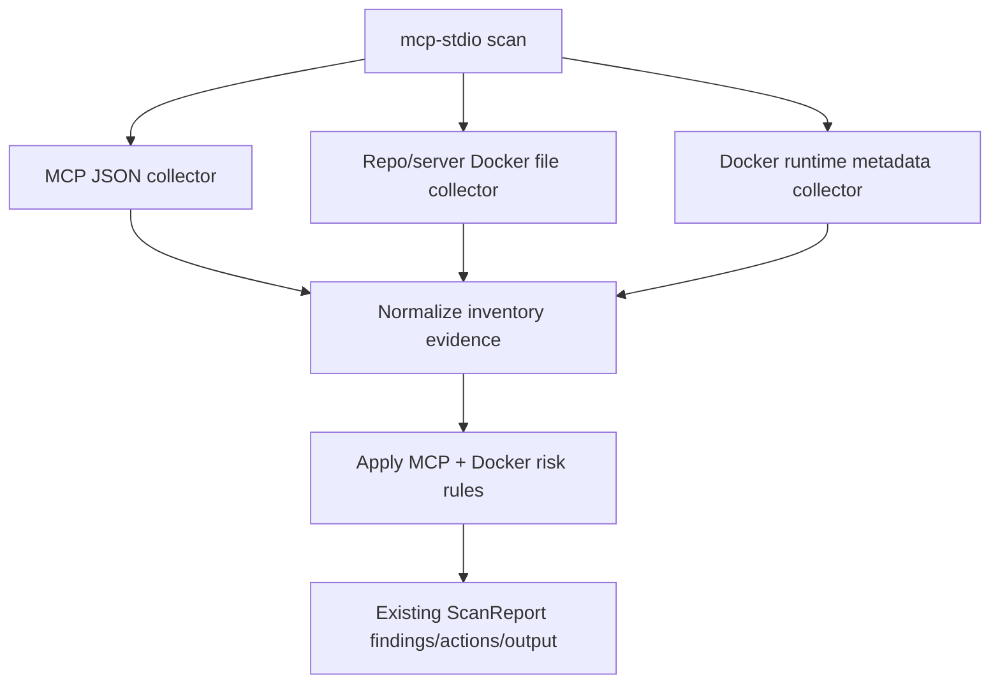

# feat: Expand MCP scanning to repo and Docker surfaces

## Overview

Extend `scira scan mcp-stdio` from local MCP JSON discovery into a broader offline inventory of MCP execution surfaces across repos, servers, Docker/Compose files, and local Docker runtime metadata. The UX remains one command: if the target contains Docker-related files or the host has Docker metadata available, SCIRA collects it best-effort and records limitations when unavailable.

## Problem Frame

Users should not need to know whether MCP risk is hiding in a desktop config, project config, server checkout, compose service, container mount, or running container. The incident-response posture is: "look here and tell me what MCP execution surfaces exist." Docker detection is part of that local/offline scan, not a separate mode.

## Requirements Trace

- R1. `scira scan mcp-stdio --target <path>` discovers MCP configs, Docker/Compose definitions, and Docker runtime metadata when locally available.
- R2. The scanner remains offline and metadata-only: no network calls, no registry lookups, no `docker exec`, no mutation.
- R3. Docker absence, daemon inaccessibility, malformed compose files, and permission gaps are recorded as skipped checks or limitations and do not fail the scan.
- R4. JSON output remains LLM-analyzable by extending existing MCP inventory/risk fields with Docker/repo/runtime evidence.
- R5. Text output highlights high-risk Docker/MCP findings before generic inventory findings.

## Scope Boundaries

- No CVE/advisory enrichment in this slice.
- No Docker image filesystem scanning, package installation, or command execution inside containers.
- No new CLI flags for Docker collection; no `--docker-runtime` and no `--ignore-docker`.
- No online MCP registry, npm, PyPI, or container registry checks.

## Context & Research

### Relevant Code and Patterns

- `src/main.rs` currently keeps all scanner behavior in one binary and routes `mcp-stdio` through `scan_mcp_stdio_configs`.
- MCP findings currently live under `findings.mcp_inventory` and `findings.mcp_risk_hits`, with empty vectors omitted from JSON.
- Risk summaries and text evidence are centralized in `build_summary`, `build_actions`, and `key_evidence_lines`.
- Tests are currently inline under `#[cfg(test)]` in `src/main.rs`.

### External References

- Docker `inspect` returns local Docker object metadata as JSON and supports containers, volumes, and other object types: https://docs.docker.com/reference/cli/docker/inspect/
- Docker Compose files define services, volumes, configs, secrets, ports, commands, entrypoints, and environment: https://docs.docker.com/reference/compose-file/
- Docker volumes and bind mounts determine what host/container paths are exposed: https://docs.docker.com/engine/storage/volumes/
- Claude Code project/user/local MCP config scopes make project `.mcp.json` a deliberate shared execution surface: https://docs.anthropic.com/en/docs/claude-code/mcp
- VS Code MCP config uses `mcp.json` with a top-level `servers` object and optional `inputs`: https://code.visualstudio.com/docs/copilot/reference/mcp-configuration

## Key Technical Decisions

- **Docker collection is default for `mcp-stdio`:** The user gave a target and expects SCIRA to find relevant execution surfaces; a Docker flag would leak implementation detail into UX.
- **Use structured parsing for Compose:** Add `serde_yaml = "0.9"` and parse compose files into `serde` values rather than line-scanning security-sensitive config.
- **Represent Docker evidence as MCP-adjacent findings:** Extend existing MCP inventory/risk structs instead of inventing a separate report family, preserving the current explain/report flow.
- **Runtime inspection is metadata-only:** Use `docker ps -aq` plus `docker inspect` JSON when available, never `docker exec` or container filesystem traversal.
- **Quiet best-effort Docker handling:** Docker missing/inaccessible should be recorded under `findings.skipped_checks` for the `docker_runtime` check, while malformed files and permission gaps remain in `limitations`.

## High-Level Technical Design

> *This illustrates the intended approach and is directional guidance for review, not implementation specification. The implementing agent should treat it as context, not code to reproduce.*

## Implementation Units

- [x] **Unit 1: Extend MCP evidence model**

**Goal:** Make MCP inventory/risk records expressive enough for repo, compose, and runtime evidence.

**Requirements:** R1, R4, R5

**Dependencies:** Current `mcp-stdio` implementation.

**Files:**
- Modify: `src/main.rs`
- Test: `src/main.rs`

**Approach:**
- Extend `McpServerFinding` with optional fields for `source_kind`, `container_name`, `image`, `service_name`, `mounts`, `ports`, and `runtime_state`, reusing the existing `env_keys` field and preserving empty-field omission where practical.
- Keep `McpRiskHit` as the single risk record type, adding categories for Docker/repo/runtime risk.
- Update `key_evidence_lines` so high-risk MCP/Docker findings appear before low-risk STDIO inventory.

**Patterns to follow:**
- Existing `serde(default, skip_serializing_if = "Vec::is_empty")` MCP fields.
- Existing text rendering through `key_evidence_lines`.

**Test scenarios:**
- Happy path: runtime/container inventory serializes into the existing `findings` object and leaves old package profiles unchanged.
- Edge case: empty optional Docker fields do not add noisy JSON to package-only scans.
- Integration: high-risk Docker/MCP risk appears in text evidence before low-risk inventory.

**Verification:**
- Existing `litellm`, `axios`, and `mcp-stdio` report shapes still serialize successfully.

- [x] **Unit 2: Add static Docker/Compose repository collector**

**Goal:** Discover Docker/Compose files under the target and extract services, commands, env keys, ports, mounts, and mounted MCP config paths.

**Requirements:** R1, R2, R3, R4

**Dependencies:** Unit 1.

**Files:**
- Modify: `Cargo.toml`
- Modify: `Cargo.lock`
- Modify: `src/main.rs`
- Test: `src/main.rs`

**Approach:**
- Add `serde_yaml = "0.9"` for compose parsing.
- Include `Dockerfile`, `docker-compose.yml`, `docker-compose.yaml`, `compose.yml`, `compose.yaml`, `.env`, and `.env.example` in the MCP scan candidate set.
- Parse compose service definitions for `image`, `command`, `entrypoint`, `environment`, `env_file`, `volumes`, `ports`, `network_mode`, `labels`, `configs`, and `secrets`.
- Parse Dockerfiles conservatively for `FROM`, `CMD`, `ENTRYPOINT`, `ENV`, `EXPOSE`, and `VOLUME`.
- Normalize discovered services/images into MCP inventory only when they mention MCP-related markers or expose MCP-relevant files, commands, mounts, labels, env keys, or config paths.

**Patterns to follow:**
- Existing `collect_candidate_files` and limitation recording for unreadable/malformed files.
- Existing JSON parsing style that records malformed files as `not_inspected` rather than failing the scan.

**Test scenarios:**
- Happy path: compose service mounting `.mcp.json` creates inventory evidence and an MCP config exposure risk.
- Happy path: Dockerfile with `CMD ["mcp-server"]` creates MCP runtime-adjacent inventory evidence.
- Edge case: compose service with unrelated app image and no MCP markers is ignored unless it exposes sensitive MCP-relevant mounts.
- Error path: malformed compose YAML records `not_inspected` and scan continues.
- Error path: unreadable compose file records permission limitation and scan continues.

**Verification:**
- Static repo/server scanning finds MCP-relevant Docker surfaces without needing a Docker daemon.

- [x] **Unit 3: Add Docker runtime metadata collector**

**Goal:** Inspect local Docker container metadata best-effort as part of default `mcp-stdio` scans.

**Requirements:** R1, R2, R3, R4

**Dependencies:** Unit 1.

**Files:**
- Modify: `src/main.rs`
- Test: `src/main.rs`

**Approach:**
- Detect Docker CLI availability with the existing command helper pattern.
- Run local metadata inspection only through Docker CLI JSON output: list container IDs, inspect them, and parse returned JSON.
- Extract container name, image, command, entrypoint, env keys, mounts, ports, labels, network mode, state, and compose labels when present.
- Treat Docker unavailable, daemon inaccessible, empty runtime, and invalid inspect JSON as `docker_runtime` skipped checks, not fatal errors.
- Do not run commands inside containers.

**Patterns to follow:**
- Existing `scan_npm_environment` command-availability and skipped-check handling.
- Existing `run_command_capture` / `CommandOutput` helpers.

**Test scenarios:**
- Happy path: Docker inspect fixture with an MCP-like container creates runtime inventory.
- Happy path: inspect fixture with writable Docker socket mount creates high-risk finding.
- Edge case: empty `docker ps -aq` produces no findings and no scan failure.
- Error path: Docker CLI missing records a `docker_runtime` skipped check.
- Error path: Docker daemon permission error records a `docker_runtime` skipped check and continues.

**Verification:**
- `mcp-stdio` succeeds on hosts with and without Docker access.

- [x] **Unit 4: Add Docker/MCP risk rules**

**Goal:** Classify Docker static/runtime evidence into actionable MCP supply-chain risk categories.

**Requirements:** R2, R4, R5

**Dependencies:** Units 1, 2, and 3.

**Files:**
- Modify: `src/main.rs`
- Test: `src/main.rs`

**Approach:**
- Add high-risk categories for writable Docker socket mounts, writable host root/home mounts, writable mounted MCP config files, and shell/package-runner MCP execution inside compose/runtime metadata.
- Add medium-risk categories for credential path mounts, secret-like env keys, public MCP-like port bindings, unpinned MCP package-runner commands, and compose services that can mutate mounted MCP config.
- Add low-risk inventory category for MCP-like containers/services with no stronger finding.
- Reuse existing MCP command risk helpers where command/entrypoint data maps cleanly to `command`/`args`; add small Docker-specific helpers only where needed.

**Patterns to follow:**
- Existing `assess_mcp_server_risks` severity/category/evidence/recommendation style.
- Existing `build_summary` status mapping where high risk means `likely_affected`, and medium/low inventory means follow-up needed.

**Test scenarios:**
- Happy path: `/var/run/docker.sock` bind mount produces `high` `docker_socket_mount`.
- Happy path: writable `$HOME` bind mount in an MCP-like service produces `high` `host_root_or_home_mount`.
- Happy path: `.aws`, `.kube`, `.ssh`, `.npmrc`, or `.env` mount produces credential exposure risk.
- Happy path: public port binding on MCP-like service produces medium risk.
- Edge case: read-only credential mount is lower severity than writable credential mount.
- Edge case: unrelated container with no MCP markers but Docker socket mount still produces risk because the socket itself is privileged.

**Verification:**
- Risk output gives evidence and remediation text clear enough for LLM explanation without extra inference.

- [x] **Unit 5: Update docs and bundled MCP guidance**

**Goal:** Make the broader scan behavior understandable without adding CLI complexity.

**Requirements:** R1, R2, R3, R5

**Dependencies:** Units 1-4.

**Files:**
- Modify: `README.md`
- Modify: `bundled/mcp-supply-chain-response/SKILL.md`
- Modify: `bundled/mcp-supply-chain-response/references/ioc-patterns.md`

**Approach:**
- Document that `mcp-stdio` scans target files and local Docker metadata best-effort by default.
- Emphasize offline/no-network/no-mutation/no-`docker exec` trust boundaries.
- Add Docker/Compose remediation guidance: remove unused mounts, avoid Docker socket exposure, make MCP config mounts read-only, pin package runners, review secret reachability.

**Patterns to follow:**
- Existing README "Built-in incident response", "Quick start", "Trust model", and "Bundled intelligence" sections.

**Test scenarios:**
- Test expectation: none -- documentation-only behavior once implementation tests cover scanner behavior.

**Verification:**
- README examples remain short and do not introduce Docker flags.

## System-Wide Impact

- **Interaction graph:** `run_scan_command` continues to route through `perform_scan`; only the `mcp-stdio` branch expands its collectors.
- **Error propagation:** Docker/Compose collector errors should become limitations or skipped checks, not top-level operational errors unless the target itself is inaccessible.
- **State lifecycle risks:** No persistent state is introduced; runtime inspection must not mutate Docker state.
- **API surface parity:** `scan` and `explain` continue to work with the same command shape. JSON expands only through optional MCP fields.
- **Integration coverage:** Tests should cover report serialization, text evidence ordering, and limitations from collector failures.
- **Unchanged invariants:** Package incident profiles should not run Docker collectors or expose MCP fields when empty.

## Risks & Dependencies

| Risk | Mitigation |
|------|------------|
| Docker inspection exposes sensitive metadata | Keep it local/offline, avoid command execution, avoid printing values for env vars, and record env keys only. |
| Compose parsing creates dependency risk | Use a structured parser and keep parsing limited to known service/config fields. |
| Noisy findings overwhelm users | Only create Docker inventory for MCP-like services or intrinsically privileged surfaces; record Docker-unavailable runtime checks as skipped checks rather than visible limitations. |
| `src/main.rs` is growing large | Keep helper boundaries clear inside the file for this slice; defer module split unless implementation becomes hard to safely test. |
| Existing package scans regress | Keep Docker collection behind `profile.ecosystem == "mcp"` and add serialization tests for old profiles. |

## Documentation / Operational Notes

- This feature should be described as offline host/repo/runtime metadata collection.
- Do not imply SCIRA proves a container or MCP server executed malicious code; it identifies execution surfaces and supply-chain risk.
- Future bundled CVE/advisory data can build on this inventory without changing the command UX.

## Sources & References

- Related code: `src/main.rs`
- Related docs: `README.md`
- Bundled skill context: `bundled/mcp-supply-chain-response/SKILL.md`
- Docker inspect docs: https://docs.docker.com/reference/cli/docker/inspect/
- Docker Compose reference: https://docs.docker.com/reference/compose-file/
- Docker volumes docs: https://docs.docker.com/engine/storage/volumes/
- Claude Code MCP docs: https://docs.anthropic.com/en/docs/claude-code/mcp
- VS Code MCP config docs: https://code.visualstudio.com/docs/copilot/reference/mcp-configuration
